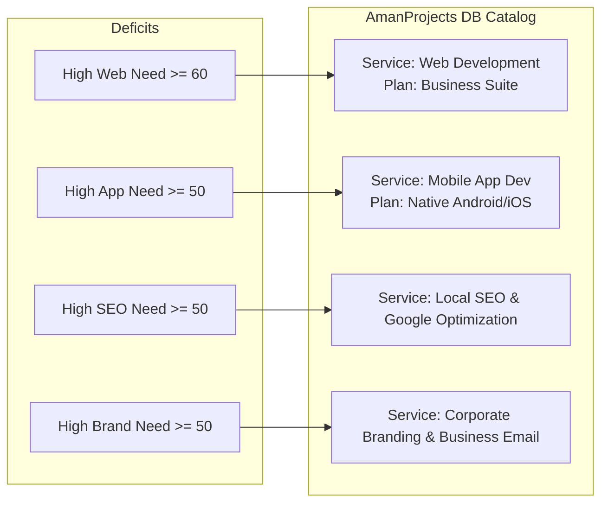
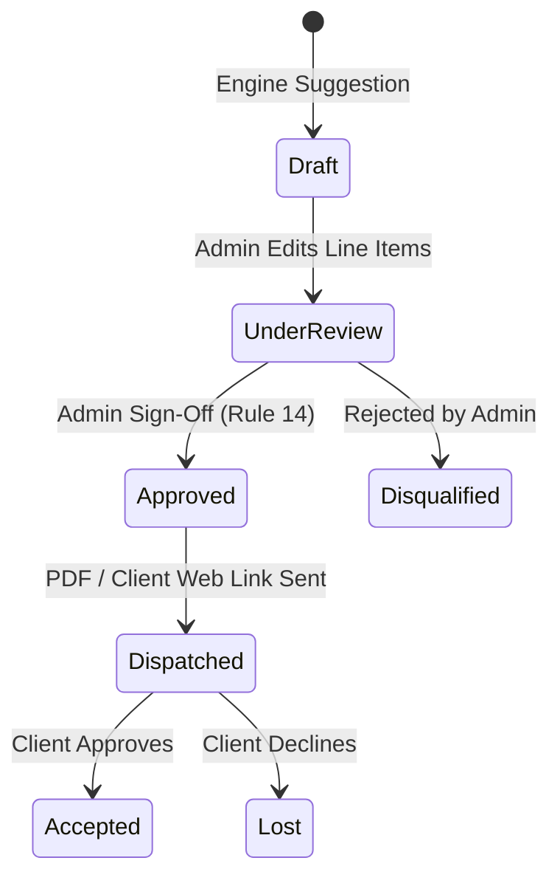

# 🧠 Digital Opportunity Analysis & Recommendation Logic

> **Document Version:** 1.0.0  
> **Module:** Opportunity Scoring, Deficit Detection & Proposal Mapping Engine  
> **Target:** AmanProjects CRM Service Layer  
> **Integrations:** AmanProjects `services` & `plans` Database Tables

---

## 1. Engine Objective & Philosophy

The **Opportunity Analysis Engine** analyzes a business lead's digital presence to uncover verifiable digital deficits. It turns raw contact points into actionable, client-tailored value propositions.

### Guiding Principles:
1. **Deficit-Driven Value:** We do not pitch generic services. We pitch solutions that fix demonstrable problems (e.g. lack of SSL, unoptimized mobile layouts, absence of custom domain email).
2. **Deterministic & Objective:** Every score is calculated using transparent, reproducible rules—not arbitrary AI hallucinations.
3. **Strict Database-Backed Pricing (Rule 13):** Quotations strictly derive from active records in the `services` and `plans` tables. No AI-generated or arbitrary price values are permitted.
4. **Mandatory Human-in-the-Loop Approval (Rule 14):** All generated proposals default to `draft` and must be signed off by a human administrator before dispatch.

---

## 2. Multi-Vector Digital Assessment Framework

The analysis engine evaluates a business across four distinct pillars, producing an individual **Need Score (0–100)** for each:

```
                            ┌─────────────────────────────────┐
                            │    Digital Opportunity Score    │
                            │             (0 - 100)           │
                            └────────────────┬────────────────┘
                                             │
      ┌──────────────────┬───────────────────┴───────────────────┬──────────────────┐
      ▼                  ▼                                       ▼                  ▼
┌───────────┐      ┌───────────┐                           ┌───────────┐      ┌───────────┐
│ Web Need  │      │ App Need  │                           │ SEO Need  │      │Brand Need │
│  Weight:  │      │  Weight:  │                           │  Weight:  │      │  Weight:  │
│    35%    │      │    25%    │                           │    20%    │      │    20%    │
└───────────┘      └───────────┘                           └───────────┘      └───────────┘
```

---

## 3. Mathematical Scoring Formulas

### 3.1 Web Need Score ($S_{web}$, Weight: 35%)
Evaluates whether the business has a functional, modern, secure website.

$$S_{web} = \sum (\text{Deficit Points}) \quad \text{capped at 100}$$

| Deficit Condition | Points | Rationale |
|---|---|---|
| **No Website at all** | +100 | Total digital absence; highest priority opportunity |
| **Non-Secure (HTTP only, no SSL)** | +30 | Security warning in Chrome; high bounce rate |
| **Missing Viewport Tag / Non-Mobile** | +35 | Fails Google mobile-friendly test |
| **Slow TTFB (> 2.0s)** | +20 | Poor user experience and high drop-off |
| **Outdated Tech Stack (e.g. Flash, Old CMS)**| +15 | Security vulnerability & maintenance bottleneck |
| **Broken Links / 4xx/5xx Errors** | +25 | Degraded user trust |

---

### 3.2 Mobile Application Need Score ($S_{app}$, Weight: 25%)
Evaluates whether the business model would benefit from a dedicated customer or operational mobile app.

| Business Indicator | Points | Fit Assessment |
|---|---|---|
| **Category: Restaurant / Food Delivery** | +40 | Online ordering, loyalty rewards, table booking |
| **Category: Retail / Boutique / E-Commerce** | +35 | Direct customer shopping, push notifications |
| **Category: Healthcare / Clinic / Salon** | +35 | Appointment scheduling and patient records |
| **Category: Logistics / Services / Rentals** | +30 | Booking tracking and instant customer chat |
| **High Review Volume (> 100 reviews)** | +20 | Large active customer base ready for an app |

---

### 3.3 Local SEO & Visibility Need Score ($S_{seo}$, Weight: 20%)
Evaluates whether the business is easily discoverable online.

| Condition | Points | Rationale |
|---|---|---|
| **Unclaimed or Incomplete Profile** | +30 | Missing business hours, category, or description |
| **Low Review Count (< 10 reviews)** | +30 | Lacks social proof; suppressed in local search pack |
| **Low Average Rating (< 3.8 stars)** | +25 | Reputation recovery opportunity |
| **No Structured Schema (JSON-LD)** | +20 | Misses Google Rich Snippets & Knowledge Graph |
| **Inconsistent NAP (Name, Address, Phone)** | +20 | Damages local search ranking authority |

---

### 3.4 Professional Brand & Contact Need Score ($S_{brand}$, Weight: 20%)
Evaluates the professionalism and reachability of the business.

| Condition | Points | Rationale |
|---|---|---|
| **Generic Email (@gmail.com, @yahoo.com)** | +35 | Lacks corporate credibility; needs custom Google Workspace/cPanel mail |
| **No Social Media Presence (0 profiles)** | +30 | Untapped audience engagement channels |
| **Broken or Inactive Social Links** | +20 | Poor digital upkeep |
| **No Landline / Virtual Number** | +15 | Needs professional VoIP / IVR routing |

---

### 3.5 Composite Opportunity Score ($S_{composite}$)

$$S_{composite} = (S_{web} \times 0.35) + (S_{app} \times 0.25) + (S_{seo} \times 0.20) + (S_{brand} \times 0.20)$$

#### Score Interpretation:
- **80 – 100:** **High Priority Opportunity** (Severe digital deficiencies; pitch web development & full digital overhaul).
- **50 – 79:** **Moderate Opportunity** (Decent foundation but notable gaps; pitch SEO, mobile responsiveness, or custom app).
- **20 – 49:** **Niche Opportunity** (Strong presence; pitch specialized optimizations, custom SaaS, or speed tuning).
- **0 – 19:** **Low Priority** (Fully mature digital footprint; monitor only).

---

## 4. Service Recommendation & Proposal Mapping

When $S_{composite}$ is calculated, the engine analyzes the highest-ranking individual need scores and maps them to active records in the AmanProjects database:



### Recommendation Mapping Matrix:

| Primary Trigger | Target `services` Record | Target `plans` Tier | Standard DB Scope |
|---|---|---|---|
| **$S_{web} \ge 60$** | `Service::where('slug', 'website-developer-in-saharsa')` | `Plan::where('name', 'Professional')` | Custom responsive UI, SSL setup, CMS integration, fast loading speed |
| **$S_{app} \ge 50$** | `Service::where('slug', 'mobile-app-development')` | `Plan::where('name', 'Standard')` | Flutter/React Native cross-platform app, push notifications, admin panel |
| **$S_{seo} \ge 50$** | `Service::where('slug', 'seo-marketing')` | `Plan::where('name', 'Growth')` | Local schema injection, Google business profile optimization, citations |
| **$S_{brand} \ge 50$** | `Service::where('slug', 'cybersecurity-services-in-saharsa')` | `Plan::where('name', 'Starter')` | Branded email setup, SSL certificate installation, security headers |

---

## 5. Proposal Generation Rules & Constraints



### Rule Enforcements:
1. **Zero Hardcoded Prices:** Every proposal line item MUST specify valid `service_id` and optional `plan_id` foreign keys matching the database.
2. **Approval Gatekeeper:** The system enforces `proposal.status = 'draft'` upon generation. The `approved_at` and `approved_by_user_id` fields must be populated via an authenticated admin session before the public link or dispatch action is unlocked.
3. **Audit Trail:** Every calculation, score update, and human edit is permanently logged in `opportunity_analyses` and `activity_logs`.
