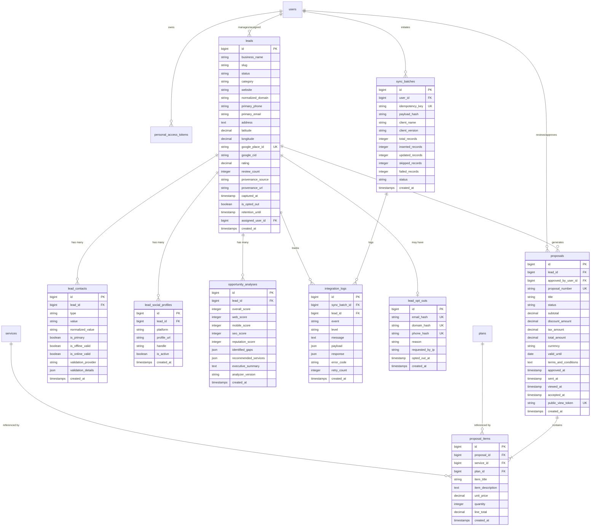

# 🗄️ Database Schema & Relational Blueprint

> **Document Version:** 1.0.0  
> **Target Database:** MySQL 8.0+ / MariaDB 10.4+  
> **ORM:** Laravel 12 Eloquent  
> **Status:** Architecture Blueprint

---

## 1. Existing Schema Analysis

AmanProjects currently manages its core agency operations across foundational tables:
- **`users`**, **`roles`**, **`permissions`**, **`role_user`**, **`permission_role`**: Standard RBAC system.
- **`contacts`**: Stores inbound website inquiries (`name`, `email`, `subject`, `message`, `read`, `replied_at`).
- **`services`**: Service catalog with dynamic JSON fields (`features`, `pricing_tiers`, `process_steps`, `faqs`).
- **`plans`**: Flat pricing plan definitions (`name`, `price`, `period`, `features`).
- **`projects`**, **`albums`**, **`album_images`**: Portfolio showcase entities.
- **`posts`**, **`categories`**, **`post_category`**: Publishing CMS.
- **`activity_logs`**, **`login_histories`**, **`settings`**: Administrative tracking.

---

## 2. Proposed Relational Entity Diagram



---

## 3. Migration Specifications & Table Blueprints

### 3.1 Migration: `create_personal_access_tokens_table` (Sanctum)
```php
Schema::create('personal_access_tokens', function (Blueprint $table) {
    $table->id();
    $table->morphs('tokenable');
    $table->string('name');
    $table->string('token', 64)->unique();
    $table->text('abilities')->nullable();
    $table->timestamp('last_used_at')->nullable();
    $table->timestamp('expires_at')->nullable();
    $table->timestamps();
});
```

### 3.2 Migration: `create_leads_table`
```php
Schema::create('leads', function (Blueprint $table) {
    $table->id();
    $table->string('business_name');
    $table->string('slug')->index();
    $table->enum('status', [
        'new', 'verified', 'analyzed', 'contacted', 'proposal_sent', 'won', 'lost', 'disqualified'
    ])->default('new')->index();
    $table->string('category')->nullable()->index();
    $table->string('website')->nullable();
    $table->string('normalized_domain')->nullable()->index();
    $table->string('primary_phone')->nullable()->index();
    $table->string('primary_email')->nullable()->index();
    $table->text('address')->nullable();
    $table->decimal('latitude', 10, 7)->nullable();
    $table->decimal('longitude', 10, 7)->nullable();
    $table->string('google_place_id')->nullable()->unique();
    $table->string('google_cid')->nullable()->index();
    $table->decimal('rating', 3, 2)->default(0.00);
    $table->unsignedInteger('review_count')->default(0);
    
    // Provenance & Compliance
    $table->string('provenance_source')->default('manual_research'); // 'extension_assisted', 'manual_entry', 'public_registry'
    $table->text('provenance_url')->nullable();
    $table->timestamp('captured_at')->nullable();
    $table->boolean('is_opted_out')->default(false)->index();
    $table->timestamp('retention_until')->nullable()->index();
    
    // Assignment & Tracking
    $table->foreignId('assigned_user_id')->nullable()->constrained('users')->nullOnDelete();
    $table->softDeletes();
    $table->timestamps();

    // Composite indexes for fast query resolution
    $table->index(['status', 'rating']);
    $table->index(['normalized_domain', 'primary_phone']);
});
```

### 3.3 Migration: `create_lead_contacts_table`
```php
Schema::create('lead_contacts', function (Blueprint $table) {
    $table->id();
    $table->foreignId('lead_id')->constrained('leads')->cascadeOnDelete();
    $table->enum('type', ['email', 'phone', 'mobile', 'whatsapp'])->index();
    $table->string('value');
    $table->string('normalized_value')->index(); // E.164 phone or lowercase email
    $table->boolean('is_primary')->default(false);
    $table->boolean('is_offline_valid')->default(false);
    $table->boolean('is_online_valid')->default(false);
    $table->string('validation_provider')->nullable(); // 'dns_mx', 'twilio_lookup', 'numverify'
    $table->json('validation_details')->nullable();
    $table->timestamps();

    $table->unique(['lead_id', 'type', 'normalized_value']);
});
```

### 3.4 Migration: `create_lead_social_profiles_table`
```php
Schema::create('lead_social_profiles', function (Blueprint $table) {
    $table->id();
    $table->foreignId('lead_id')->constrained('leads')->cascadeOnDelete();
    $table->enum('platform', ['instagram', 'facebook', 'linkedin', 'twitter', 'youtube', 'yelp', 'other'])->index();
    $table->text('profile_url');
    $table->string('handle')->nullable();
    $table->boolean('is_active')->default(true);
    $table->timestamps();

    $table->unique(['lead_id', 'platform']);
});
```

### 3.5 Migration: `create_opportunity_analyses_table`
```php
Schema::create('opportunity_analyses', function (Blueprint $table) {
    $table->id();
    $table->foreignId('lead_id')->constrained('leads')->cascadeOnDelete();
    $table->unsignedTinyInteger('overall_score')->default(0); // 0 - 100
    $table->unsignedTinyInteger('web_score')->default(0);
    $table->unsignedTinyInteger('mobile_score')->default(0);
    $table->unsignedTinyInteger('seo_score')->default(0);
    $table->unsignedTinyInteger('reputation_score')->default(0);
    $table->json('identified_gaps'); // ['no_ssl', 'missing_mobile_viewport', 'no_branded_email', 'low_reviews']
    $table->json('recommended_services'); // [{service_id: 1, plan_id: 2, confidence: 95}]
    $table->text('executive_summary')->nullable();
    $table->string('analyzer_version', 20)->default('1.0.0');
    $table->timestamps();
});
```

### 3.6 Migration: `create_proposals_table` & `create_proposal_items_table`
```php
Schema::create('proposals', function (Blueprint $table) {
    $table->id();
    $table->foreignId('lead_id')->constrained('leads')->cascadeOnDelete();
    $table->foreignId('approved_by_user_id')->nullable()->constrained('users')->nullOnDelete();
    $table->string('proposal_number', 50)->unique();
    $table->string('title');
    $table->enum('status', ['draft', 'under_review', 'approved', 'sent', 'viewed', 'accepted', 'rejected', 'expired'])
          ->default('draft')->index();
    $table->decimal('subtotal', 10, 2)->default(0.00);
    $table->decimal('discount_amount', 10, 2)->default(0.00);
    $table->decimal('tax_amount', 10, 2)->default(0.00);
    $table->decimal('total_amount', 10, 2)->default(0.00);
    $table->string('currency', 3)->default('INR');
    $table->date('valid_until');
    $table->text('terms_and_conditions')->nullable();
    
    // Security & Access
    $table->string('public_view_token', 64)->unique();
    $table->timestamp('approved_at')->nullable();
    $table->timestamp('sent_at')->nullable();
    $table->timestamp('viewed_at')->nullable();
    $table->timestamp('accepted_at')->nullable();
    $table->softDeletes();
    $table->timestamps();
});

Schema::create('proposal_items', function (Blueprint $table) {
    $table->id();
    $table->foreignId('proposal_id')->constrained('proposals')->cascadeOnDelete();
    $table->foreignId('service_id')->nullable()->constrained('services')->nullOnDelete();
    $table->foreignId('plan_id')->nullable()->constrained('plans')->nullOnDelete();
    $table->string('item_title');
    $table->text('item_description')->nullable();
    $table->decimal('unit_price', 10, 2);
    $table->unsignedInteger('quantity')->default(1);
    $table->decimal('line_total', 10, 2);
    $table->timestamps();
});
```

### 3.7 Migration: `create_sync_batches_table` & `create_integration_logs_table`
```php
Schema::create('sync_batches', function (Blueprint $table) {
    $table->id();
    $table->foreignId('user_id')->constrained('users')->cascadeOnDelete();
    $table->string('idempotency_key', 64)->unique();
    $table->string('payload_hash', 64);
    $table->string('client_name')->default('LeadHarvest');
    $table->string('client_version')->default('1.9.1');
    $table->unsignedInteger('total_records')->default(0);
    $table->unsignedInteger('inserted_records')->default(0);
    $table->unsignedInteger('updated_records')->default(0);
    $table->unsignedInteger('skipped_records')->default(0);
    $table->unsignedInteger('failed_records')->default(0);
    $table->enum('status', ['processing', 'completed', 'failed'])->default('processing');
    $table->timestamps();
});

Schema::create('integration_logs', function (Blueprint $table) {
    $table->id();
    $table->foreignId('sync_batch_id')->nullable()->constrained('sync_batches')->cascadeOnDelete();
    $table->foreignId('lead_id')->nullable()->constrained('leads')->nullOnDelete();
    $table->string('event', 100)->index();
    $table->enum('level', ['debug', 'info', 'warning', 'error', 'critical'])->default('info');
    $table->text('message');
    $table->json('payload')->nullable();
    $table->json('response')->nullable();
    $table->string('error_code', 50)->nullable();
    $table->unsignedSmallInteger('retry_count')->default(0);
    $table->timestamps();
});
```

### 3.8 Migration: `create_lead_opt_outs_table`
```php
Schema::create('lead_opt_outs', function (Blueprint $table) {
    $table->id();
    $table->string('email_hash', 64)->nullable()->unique();
    $table->string('domain_hash', 64)->nullable()->unique();
    $table->string('phone_hash', 64)->nullable()->unique();
    $table->string('reason')->nullable();
    $table->ipAddress('requested_by_ip')->nullable();
    $table->timestamp('opted_out_at');
    $table->timestamps();
});
```

---

## 4. Eloquent Model Relationships

### `App\Models\Lead`
```php
class Lead extends Model
{
    use HasFactory, SoftDeletes;

    protected $fillable = [
        'business_name', 'slug', 'status', 'category', 'website',
        'normalized_domain', 'primary_phone', 'primary_email', 'address',
        'latitude', 'longitude', 'google_place_id', 'google_cid', 'rating',
        'review_count', 'provenance_source', 'provenance_url', 'captured_at',
        'is_opted_out', 'retention_until', 'assigned_user_id'
    ];

    public function contacts(): HasMany { return $this->hasMany(LeadContact::class); }
    public function socialProfiles(): HasMany { return $this->hasMany(LeadSocialProfile::class); }
    public function opportunityAnalyses(): HasMany { return $this->hasMany(OpportunityAnalysis::class); }
    public function latestAnalysis(): HasOne { return $this->hasOne(OpportunityAnalysis::class)->latestOfMany(); }
    public function proposals(): HasMany { return $this->hasMany(Proposal::class); }
    public function integrationLogs(): HasMany { return $this->hasMany(IntegrationLog::class); }
    public function assignedUser(): BelongsTo { return $this->belongsTo(User::class, 'assigned_user_id'); }
}
```

### `App\Models\Proposal`
```php
class Proposal extends Model
{
    use HasFactory, SoftDeletes;

    protected $fillable = [
        'lead_id', 'approved_by_user_id', 'proposal_number', 'title',
        'status', 'subtotal', 'discount_amount', 'tax_amount', 'total_amount',
        'currency', 'valid_until', 'terms_and_conditions', 'public_view_token',
        'approved_at', 'sent_at', 'viewed_at', 'accepted_at'
    ];

    public function lead(): BelongsTo { return $this->belongsTo(Lead::class); }
    public function items(): HasMany { return $this->hasMany(ProposalItem::class); }
    public function approver(): BelongsTo { return $this->belongsTo(User::class, 'approved_by_user_id'); }
}
```

---

## 5. Retention & Soft Deletion Policy

1. **Active Retention Window:** Unconverted leads are assigned a `retention_until` timestamp calculated as `captured_at + 90 days`.
2. **Automated Pruning Job:** A scheduled console command (`php artisan leads:prune-retention`) soft-deletes expired leads that have no active proposals or ongoing client engagements.
3. **Opt-Out Erasure:** Any lead registered in `lead_opt_outs` is immediately anonymized: `business_name`, `phone`, `email`, and `address` fields are scrubbed, retaining only hashed identifiers to prevent future re-importation.
