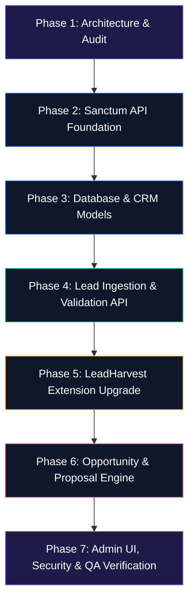

# 🗺️ Implementation Plan — AmanProjects & LeadHarvest Platform

> **Document Version:** 1.0.0  
> **Status:** Implementation Blueprint  
> **Frameworks:** Laravel 12 (CRM/API) & Chrome Extension Manifest V3  
> **Standard:** Atomic, Non-Destructive, Test-Driven Execution

---

## 1. Engineering Roadmap Overview

The implementation is structured into **seven sequential phases**. Each phase is completely isolated, self-validating, and designed to preserve 100% of existing AmanProjects functionality.



---

## 2. Work Breakdown Structure (WBS)

### Phase 1: Complete Repository Audit & Documentation
*Objective: Audit codebase, define architecture contracts, and draft all specifications without modifying code.*
- [x] Audit AmanProjects directory structure, routes, controllers, models, and migrations.
- [x] Audit LeadHarvest extension manifest, background service worker, and DOM scripts.
- [x] Draft `PROJECT_OVERVIEW.md`
- [x] Draft `IMPLEMENTATION_PLAN.md`
- [x] Draft `DATABASE_SCHEMA.md`
- [x] Draft `API_DOCUMENTATION.md`
- [x] Draft `ANALYSIS_LOGIC.md`
- [x] Draft `SECURITY_POLICY.md`
- [x] Draft `INTEGRATION_WORKFLOW.md`
- [x] Draft `TESTING_CHECKLIST.md`

### Phase 2: Sanctum API Foundation & Core Routing
*Objective: Prepare AmanProjects to receive authenticated REST calls from the extension.*
- **Step 2.1:** Install & configure `laravel/sanctum` via Composer.
- **Step 2.2:** Publish Sanctum migration (`personal_access_tokens`) without executing against production DB yet.
- **Step 2.3:** Add `HasApiTokens` trait to `App\Models\User`.
- **Step 2.4:** Configure `bootstrap/app.php` to register `api: __DIR__.'/../routes/api.php'` with prefix `api/v1`.
- **Step 2.5:** Create `config/cors.php` and configure allowed headers, methods, and extension origins (`chrome-extension://*`).
- **Step 2.6:** Implement `App\Http\Controllers\Api\V1\AuthController` (`issueToken`, `revokeToken`, `me`).
- **Step 2.7:** Create automated API authentication tests in `tests/Feature/Api/AuthTest.php`.

### Phase 3: CRM Database Schema & Eloquent Models
*Objective: Establish relational tables for leads, verification records, analyses, proposals, and sync logs.*
- **Step 3.1:** Create migration for `leads` table (fields: business name, slug, status, website, phone, email, address, coordinates, place_id, CID, provenance source, opt_out).
- **Step 3.2:** Create migration for `lead_contacts` (normalized sub-contacts, department, primary flags, offline/online validation states).
- **Step 3.3:** Create migration for `lead_social_profiles` (platform, url, handle, status).
- **Step 3.4:** Create migration for `opportunity_analyses` (web score, mobile score, SEO score, review score, identified deficiencies, recommendation payload).
- **Step 3.5:** Create migration for `proposals` and `proposal_items` (proposal token, status, total amount, validity, linked `service_id`, `plan_id`, human approval metadata).
- **Step 3.6:** Create migration for `sync_batches` and `integration_logs` (idempotency keys, payload hash, response code, error details).
- **Step 3.7:** Create migration for `lead_opt_outs` (email/domain hash, reason, request timestamp).
- **Step 3.8:** Build Eloquent Models with explicit relationships, `$fillable` protection, `$casts`, query scopes, and model observers for cache invalidation.

### Phase 4: Idempotent Sync & Validation API Endpoints
*Objective: Expose versioned endpoints for lead synchronization, duplicate detection, and live contact verification.*
- **Step 4.1:** Implement `App\Http\Requests\Api\V1\SyncLeadRequest` with strict validation rules.
- **Step 4.2:** Implement `App\Http\Controllers\Api\V1\LeadController` (`sync`, `index`, `show`, `updateStatus`).
- **Step 4.3:** Implement `IdempotentSyncMiddleware` verifying `X-Idempotency-Key` and SHA-256 payload matching.
- **Step 4.4:** Implement `App\Services\LeadValidationService` for offline phone/email format validation and online DNS/MX probing.
- **Step 4.5:** Implement `POST /api/v1/leads/validate-contact` endpoint.
- **Step 4.6:** Implement `POST /api/v1/leads/{id}/opt-out` endpoint.

### Phase 5: LeadHarvest Extension Upgrade (Manifest V3)
*Objective: Enhance LeadHarvest with API synchronization, local contact verification, and settings management.*
- **Step 5.1:** Keep extension codebase in `K:\MyExtensions\LeadHarvest` (decoupled).
- **Step 5.2:** Add extension settings tab in `popup.html` / `dashboard.html` for API endpoint URL (`https://.../api/v1`) and Sanctum Bearer token.
- **Step 5.3:** Build `js/api-client.js` module handling authenticated Axios/Fetch calls with auto-retry and idempotency token generation.
- **Step 5.4:** Implement client-side `js/validator.js`:
  - **Phone Validator:** E.164 normalization, country code detection, regex validation for mobile/landline.
  - **Email Validator:** RFC 5322 regex syntax check, disposable domain blacklist, MX record lookup via API.
  - **Website Validator:** HTTP/HTTPS resolution, redirection following, SSL certificate check.
- **Step 5.5:** Update `dashboard.js` with "Sync to AmanProjects CRM" button with real-time status badges (`Synced`, `Duplicate`, `Failed`).

### Phase 6: Digital Opportunity Analysis & Proposal Builder
*Objective: Build backend intelligence calculating digital need scores and generating human-approved proposals.*
- **Step 6.1:** Implement `App\Services\OpportunityAnalysisEngine`:
  - Web presence audit (SSL, responsive viewport, page speed proxy, tech tags).
  - Reputation audit (star rating, review volume, recency).
  - Contact audit (generic @gmail vs branded domain email, mobile presence).
- **Step 6.2:** Implement weighted scoring formula resulting in 0–100 need score.
- **Step 6.3:** Implement recommendation mapper linking scored needs to AmanProjects `Service` and `Plan` database entries.
- **Step 6.4:** Implement `App\Services\ProposalGenerator`:
  - Reference existing `services` and `plans` tables (strictly no hardcoded AI pricing).
  - Draft state creation with line items and customized quotation.
  - Mandatory admin review and approval flag (`is_approved = false` by default).

### Phase 7: Responsive Admin UI, Security Controls & QA
*Objective: Build high-conversion management views in AmanProjects admin panel and execute full test matrix.*
- **Step 7.1:** Add "Leads & Prospects" module to `resources/views/layouts/admin.blade.php` sidebar.
- **Step 7.2:** Build `resources/views/admin/leads/index.blade.php` with filterable data table (status, score, date, search).
- **Step 7.3:** Build `resources/views/admin/leads/show.blade.php` displaying lead dossier, opportunity scorecard, and audit timeline.
- **Step 7.4:** Build `resources/views/admin/proposals/builder.blade.php` with proposal customization and human approval toggle.
- **Step 7.5:** Implement automated pruning console command (`php artisan leads:prune-expired`) for compliance.
- **Step 7.6:** Execute complete Pest/PHPUnit test suite and browser validation.

---

## 3. Milestones & Delivery Schedule

| Milestone | Deliverables | Verification Criteria |
|---|---|---|
| **M1: Architecture Sign-Off** | All 8 documentation files in place | Full architectural audit approved without code modification |
| **M2: Sanctum API Live** | Sanctum installed, `/api/v1/auth/token` working | Extension receives valid bearer token; feature tests pass |
| **M3: Core CRM Data Layer** | Migrations, models, seeders, and observers | Tables exist with proper foreign keys; zero regression on existing models |
| **M4: Lead Sync Engine** | Idempotent sync API & validation services | Extension syncs single/batch leads with deduplication |
| **M5: LeadHarvest Integration** | Extension UI updated with settings & sync buttons | Real leads synced directly from extension UI into CRM |
| **M6: Opportunity & Proposals** | Gap analyzer, scorecards, and proposal builder | Leads receive digital opportunity scores; proposals require admin sign-off |
| **M7: Production Deployment** | Admin views live, security policies verified, full QA | Complete end-to-end flow tested from Chrome extension to converted project |

---

## 4. Risk Analysis & Mitigation Strategy

| Risk Identified | Impact | Probability | Mitigation Strategy |
|---|---|---|---|
| **Google Maps ToS Conflict** | High | Low | Enforce Rule 16: No automated bulk scraping. Manual research & curation only; independently verify public business web presence. |
| **Breaking Existing Routes/Views** | High | Low | Isolate all new routes in `routes/api.php` and prefix admin views under `admin/leads`. Existing `routes/web.php` remains untouched. |
| **API Token Leakage** | High | Low | Tokens stored only in `chrome.storage.local` on user device; never committed to Git. Masked tokens in logs. |
| **Duplicate Lead Flooding** | Medium | Medium | Multi-column deduplication by `place_id`, `website_normalized`, and `phone_normalized`. Idempotent sync middleware with SHA-256 hash. |
| **Invalid AI/Hardcoded Pricing** | Medium | Low | Enforce Rule 13: All line items must strictly bind to foreign keys in `services` and `plans` database tables. |
| **Unapproved Client Outreach** | High | Low | Enforce Rule 14: System blocks sending proposals without an explicit `approved_by` user ID and timestamp. |

---

## 5. Git Commit Strategy

All commits follow the **Conventional Commits** specification (`feat`, `fix`, `docs`, `refactor`, `test`, `chore`) and are organized into directory-scoped atomic units:

```bash
# Example Commit Cadence
docs: complete comprehensive repository audit and 8 enterprise specifications
feat(api-auth): configure Laravel Sanctum, api routes, and token controllers
feat(leads-db): add database migrations and Eloquent models for leads and verification
feat(sync-api): implement idempotent lead synchronization and duplicate detection
feat(validation): add offline regex and online DNS/MX contact validation services
feat(extension): integrate Sanctum API sync and client-side validators in LeadHarvest
feat(opportunity): implement digital opportunity gap scoring and service recommender
feat(proposals): create proposal generation engine with human approval workflow
feat(admin-ui): build responsive admin views for lead management and proposal review
test(platform): add end-to-end feature tests for API sync and opportunity calculations
```
