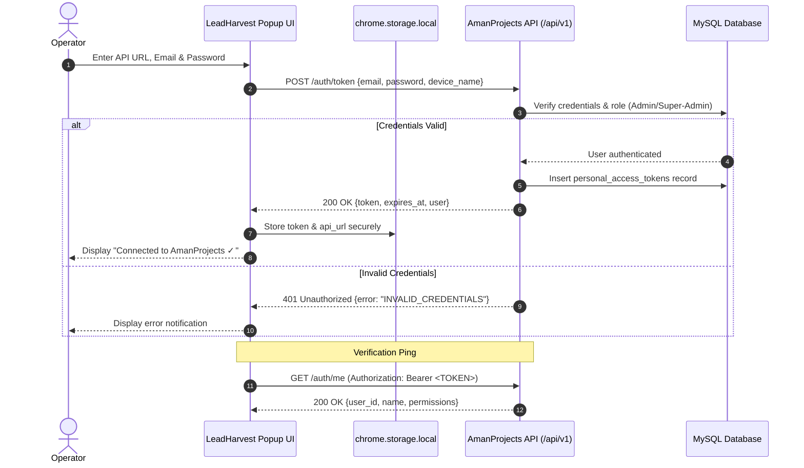
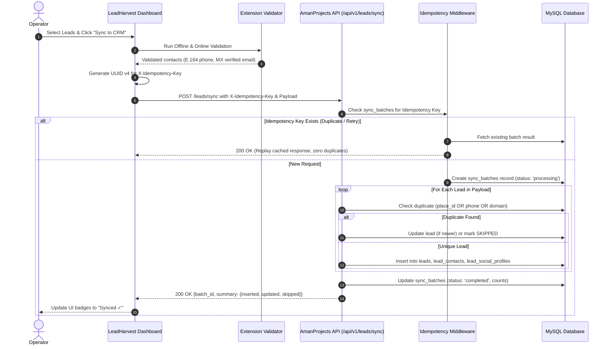
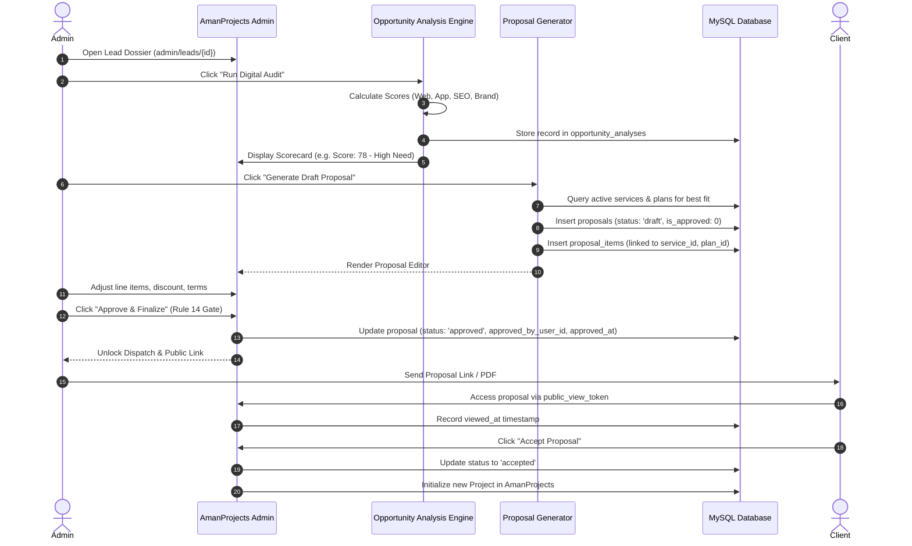

# 🔄 End-to-End Integration & Prospecting Workflow

> **Document Version:** 1.0.0  
> **Systems Involved:** LeadHarvest (Chrome MV3 Extension) & AmanProjects (Laravel 12 API / CRM)  
> **Standard:** Enterprise Asynchronous Pipeline with Idempotency Guarantees

---

## 1. High-Level Prospecting Lifecycle

The end-to-end client acquisition journey transitions through eight distinct stages across the client-extension and server-CRM boundary:

```
┌────────────────────────────────────────────────────────────────────────────────────────┐
│                                 LEADHARVEST (CLIENT)                                   │
└───────────────────────────────────────────┬────────────────────────────────────────────┘
                                            │
                                            ▼
                 [Stage 1: Business Research & Public Discovery]
                  Operator targets niche & reviews public listings.
                                            │
                                            ▼
                 [Stage 2: Client-Side Contact Verification]
                  Offline regex checks + Online MX/DNS probes.
                                            │
                                            ▼
                 [Stage 3: Idempotent REST API Synchronization]
                  Secure push to AmanProjects via Sanctum Bearer Token.
                                            │
┌───────────────────────────────────────────┴────────────────────────────────────────────┐
│                                 AMANPROJECTS (SERVER)                                  │
└───────────────────────────────────────────┬────────────────────────────────────────────┘
                                            │
                                            ▼
                 [Stage 4: CRM Ingestion & Deduplication]
                  Multi-key deduplication (Place ID, normalized phone/domain).
                                            │
                                            ▼
                 [Stage 5: Digital Opportunity & Gap Analysis]
                  Deficit scoring (Web 35%, App 25%, SEO 20%, Brand 20%).
                                            │
                                            ▼
                 [Stage 6: Service Recommendation & Proposal Draft]
                  Automated mapping to active DB catalog services & plans.
                                            │
                                            ▼
                 [Stage 7: Mandatory Human Review & Approval]
                  Operator inspects proposal in Admin UI & signs off.
                                            │
                                            ▼
                 [Stage 8: Client Conversion & Project Handover]
                  Client accepts proposal; project initialized in AmanProjects.
```

---

## 2. Sequence Diagrams

### 2.1 Extension Authentication & Health Check Workflow



---

### 2.2 Lead Synchronization & Idempotency Workflow



---

### 2.3 Opportunity Analysis & Proposal Approval Workflow



---

## 3. LeadHarvest Chrome Extension Upgrades

To support this workflow cleanly, the LeadHarvest extension (`K:\MyExtensions\LeadHarvest`) requires three modular enhancements:

### 3.1 Settings Configuration Module (`js/settings.js`)
- UI fields in `popup.html`:
  - `AmanProjects API Endpoint` (Default: `https://amanprojects.com/api/v1`)
  - `Sanctum API Bearer Token`
  - `Auto-Verify Contacts Before Sync` (Toggle)
  - `Test Connection` button

### 3.2 Dual-Layer Contact Validator (`js/validator.js`)
- **Offline Phone Validation:**
  - Standardizes raw input to E.164 international format (`+<country_code><number>`).
  - Regex checks for mobile vs landline prefixes based on territory.
- **Offline Email Validation:**
  - Strict RFC 5322 syntax validation.
  - Blacklist filter for fake/sample domains (`test.com`, `example.com`, `domain.com`).
- **Online DNS/MX Probing:**
  - Calls `POST /api/v1/leads/validate-contact` to verify active MX DNS records on target recipient domains before CRM transmission.

### 3.3 Dashboard Sync Controller (`js/sync-controller.js`)
- Extends Tabulator table in `dashboard.html`:
  - Adds checkbox selection for individual leads.
  - Adds **"Sync Selected to AmanProjects CRM"** button.
  - Displays real-time status pills: `⏳ Validating`, `🔄 Syncing`, `✅ Synced (ID: 105)`, `⚠️ Duplicate`, `❌ Failed`.
