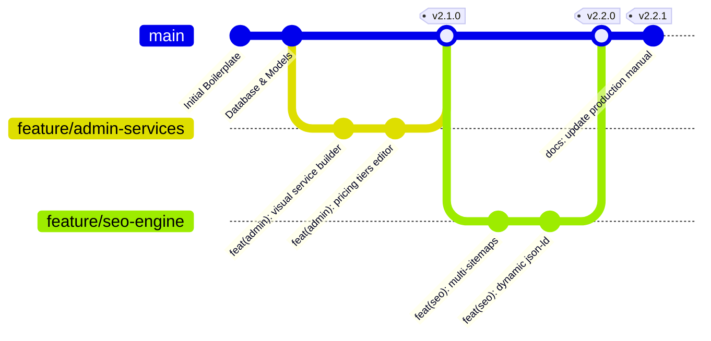

<div align="center">
  
  <h1 style="font-weight: 800; margin-top: 15px;">AmanProjects CMS & Enterprise Portfolio Platform</h1>
  <p><strong>A Next-Generation, Ultra-Fast Full-Stack Digital Agency, SaaS Showcase & Portfolio CMS built with Laravel 12 & Tailwind CSS.</strong></p>
  <p><em>Engineered for Peak Performance, Granular Caching, Deep SEO/AEO/GEO Optimization, and Effortless Admin Content Management.</em></p>

  <p>
    <a href="https://laravel.com"></a>
    <a href="https://php.net"></a>
    <a href="https://tailwindcss.com"></a>
    <a href="https://alpinejs.dev"></a>
    <a href="https://pestphp.com"></a>
    
    
  </p>
</div>

---

## 📑 Table of Contents

- [Overview](#-overview)
- [Key Features & Architecture](#-key-features--architecture)
  - [1. Granular Cache Architecture](#1-modular--granular-caching-architecture)
  - [2. SEO, AEO & GEO Mastery](#2-search-engine-optimization-seo-aeo--geo)
  - [3. Dynamic Visual Admin Control Center](#3-dynamic-visual-admin-control-center)
  - [4. Frontend Showcase & Corporate UX](#4-frontend-showcase--corporate-ux)
  - [5. Robust Security & Anti-Spam Protection](#5-security--anti-spam-shield)
- [Tech Stack](#-tech-stack)
- [Project Directory Architecture](#-project-directory-architecture)
- [Complete Routes Reference](#-complete-routes-reference)
- [Database Schema & Seeders](#-database-schema--seeders)
- [Installation & Quick Start](#-installation--quick-start)
- [Production & cPanel Deployment](#-production--cpanel-deployment)
- [Git Workflow & Branching Guidelines](#-git-workflow--branching-guidelines)
- [Contributing](#-contributing)
- [License & Authorship](#-license--authorship)

---

## 🚀 Overview

**AmanProjects CMS** is an enterprise-grade web application tailored for digital agencies, developers, freelancers, and growing businesses. Unlike traditional bloated WordPress websites or standard CRUD templates, AmanProjects is engineered from the ground up on modern **Laravel 12**, featuring:

- **Ultra-low TTFB (Time to First Byte)** powered by intelligent tag-level cache invalidation.
- **Deep search visibility** targeting local, regional, and national search landscapes with automated XML sub-sitemaps and structured JSON-LD schemas.
- **Dynamic visual administration** allowing non-technical managers to edit pricing tables, service process steps, and FAQs using an intuitive visual card builder.
- **Corporate UI aesthetics** built with modern utility CSS, micro-interactions, responsive sliders, and zero font-blocking delays.

> **Authorship & Creator:** Designed, engineered, and continuously refined by **[Technical Aman](https://amanprojects.com)**.

---

## ✨ Key Features & Architecture

### 1. Modular & Granular Caching Architecture
- **Surgical Invalidation:** Modifying a project only invalidates the project cache; blog articles, service pages, and site branding remain served directly from the memory/file cache.
- **Observer-Driven Sync:** `AppServiceProvider` registers model observers (`ProjectObserver`, `PostObserver`, `SettingObserver`) to guarantee zero cache staleness without manual intervention.
- **Zero-FOIT Asset Delivery:** Modern preloading strategies guarantee zero Flash of Invisible Text during typography rendering.
- **One-Click Manual Cache Purge:** Dedicated admin action to flush application, configuration, view, and route caches on demand.

### 2. Search Engine Optimization (SEO, AEO & GEO)
- **Multi-Sitemap Engine (`/sitemap.xml`):**
  - Project Sitemap (`/sitemap-projects.xml`)
  - Blog & Content Sitemap (`/sitemap-blogs.xml`)
  - Category Directory (`/sitemap-categories.xml`)
  - Image Assets Sitemap (`/sitemap-images.xml`)
  - Local & Regional Business Sitemap (`/sitemap-local.xml`)
- **Automated Rich Snippets & JSON-LD:**
  - `Organization` & `WebSite` schema for corporate search authority.
  - `LocalBusiness` schema for local map pack and GEO-targeted queries.
  - `BreadcrumbList` & `BlogPosting` schemas for rich Google search cards.
- **Full Social Graph Meta:** Auto-generated OpenGraph (OG) and Twitter Card tags per page, including dynamic hero fallback images and sanitized excerpts.

### 3. Dynamic Visual Admin Control Center
- **Visual UI Builders:** Replaced raw JSON textarea editors with dynamic form builders for:
  - Service Pricing Packages (name, price, currency, badge, feature checklists).
  - Step-by-Step Delivery Processes (icon, step number, title, description).
  - FAQ Accordions (question, answer, category tag).
- **Summernote WYSIWYG Editor:** Rich formatting for blog articles, project case studies, and service landing page descriptions.
- **Live System Manager:**
  - Real-time Branding Previews (logo, favicon, brand name, primary/secondary color sync).
  - Mailer & SMTP Configuration with live email delivery tester.
  - Custom Header & Footer Script Injector (Google Analytics 4, Tag Manager, AdSense verification).
  - Feature Toggles (turn off pricing tables, testimonials, or blogs with a single switch).

### 4. Frontend Showcase & Corporate UX
- **Dynamic Hero Section:** Configurable headline, call-to-action buttons, trust badges, and hero badges.
- **Album & Gallery Slider:** High-resolution project image sliders with lightbox preview and multi-angle snapshots.
- **Services Landing Pages:** Dual-route routing (`/services/{slug}` and direct clean URLs `/{slug}`) with conversion-focused consultation forms.
- **Floating Quick Navigation Drawer:** Instant access shortcut menu for mobile and desktop users.
- **Automated Slug Generation:** Title-to-slug transformation with safe fallbacks and conflict avoidance.

### 5. Security & Anti-Spam Shield
- **Role-Based Access Control (RBAC):** Middleware-enforced permissions distinguishing between `super-admin`, `admin`, and standard users.
- **Honeypot Anti-Bot Shield:** Traps automated spammers on contact forms without cumbersome CAPTCHA challenges.
- **Rate Throttling:** Strict rate limits on authentication attempts and public contact endpoints (`throttle:5,1`).
- **HTML Sanitization:** Raw input processed via `HtmlPurifier` helper to eliminate XSS vectors.

---

## 🛠 Tech Stack

| Domain | Technology / Library | Description |
| :--- | :--- | :--- |
| **Backend Framework** | Laravel 12.x | Modern PHP web application framework |
| **Language** | PHP ^8.2 | Type-safe, strict types backend runtime |
| **Frontend Styling** | Tailwind CSS v4.0 | Modern utility-first CSS framework |
| **Frontend JavaScript** | Alpine.js & Vanilla JS | Declarative, lightweight reactive UI |
| **Components & UI** | Swiper JS, AOS, Summernote | Carousels, scroll animations, rich text editor |
| **Database** | MySQL / MariaDB / SQLite | Relational database with full index optimization |
| **Testing** | Pest PHP 3.x | Elegant and fast testing framework |
| **Build Tooling** | Vite 7.x & Concurrently | Ultra-fast HMR and bundle compilation |

---

## 📂 Project Directory Architecture

```text
AmanProjects/
├── app/
│   ├── Helpers/
│   │   ├── FileHelper.php            # Universal file upload, naming & storage helper
│   │   ├── FileUrlHelper.php         # CDN and local asset URL resolver
│   │   └── HtmlPurifier.php          # XSS purification & content sanitizer
│   ├── Http/
│   │   ├── Controllers/
│   │   │   ├── Admin/                # 18+ Dedicated Admin Resource Controllers
│   │   │   │   ├── DashboardController.php
│   │   │   │   ├── ProjectController.php
│   │   │   │   ├── ServiceController.php
│   │   │   │   ├── SettingController.php
│   │   │   │   └── ...
│   │   │   ├── Auth/                 # Authentication & Session Handlers
│   │   │   ├── HomeController.php    # Frontend presentation & caching controller
│   │   │   └── SitemapController.php # High-speed XML sitemap generator
│   │   ├── Middleware/               # Role, Admin & Maintenance Gateways
│   │   └── Requests/Admin/           # Strongly validated FormRequests
│   ├── Models/                       # Eloquent Entities with Relationships & Traits
│   ├── Providers/
│   │   └── AppServiceProvider.php    # Cache invalidation observers & View Composers
│   └── Traits/
│       └── HandlesFileUploads.php    # Clean thumbnail generation & multi-file handler
├── config/                           # Application, cache, database & mail configurations
├── database/
│   ├── migrations/                   # 30+ Chronological schema migrations
│   └── seeders/                      # Production-ready demo & system data seeders
├── public/
│   ├── assets/                       # Static brand logos, hero images & icons
│   ├── css/ & js/                    # Optimized frontend scripts & styling
│   ├── ads.txt                       # Google AdSense authorized seller declaration
│   └── robots.txt                    # Search crawler indexing directives
├── resources/
│   ├── views/
│   │   ├── admin/                    # Admin Control Center Blade views & partials
│   │   ├── blog/                     # Blog index & reader views
│   │   ├── layouts/                  # App master layout & Admin dashboard master
│   │   ├── pages/                    # Services, About, Contact, Terms & Privacy
│   │   ├── partials/                 # Header, Footer, Navigation, Sitemaps
│   │   └── home.blade.php            # Modular, dynamic homepage
├── routes/
│   ├── web.php                       # Public frontend & sitemap routes
│   ├── admin.php                     # Secured admin control center routes
│   └── console.php                   # Scheduled Artisan commands
├── .cpanel.yml                       # Automated cPanel Git version-control deployment
├── composer.json                     # PHP dependencies & project scripts
└── vite.config.js                    # Vite bundler configuration
```

---

## 🧭 Complete Routes Reference

### Public Frontend Routes (`routes/web.php`)

| Method | URI Pattern | Name | Controller Action | Description |
| :--- | :--- | :--- | :--- | :--- |
| `GET` | `/` | `home` | `HomeController@index` | Main corporate portfolio homepage |
| `GET` | `/blog` | `blog` | `HomeController@blog` | Articles & insights listing |
| `GET` | `/blog/{slug}` | `blog.show` | `HomeController@blogShow` | Single article reader view |
| `GET` | `/category/{slug}` | `category.show` | `HomeController@categoryShow` | Filtered posts by category |
| `GET` | `/project` | `projects` | `HomeController@projects` | Complete portfolio projects directory |
| `GET` | `/project/{slug}` | `project.show` | `HomeController@projectShow` | Project case study & album gallery |
| `GET` | `/services/{slug}` | `services.show` | `HomeController@serviceShow` | Dynamic service landing page |
| `GET` | `/{slug}` | `services.direct` | `HomeController@serviceShow` | Direct friendly slug service routing |
| `GET` | `/about` | `about` | `HomeController@about` | Company / developer biography |
| `GET` | `/contact` | `contact` | `HomeController@showContactForm` | Public contact & inquiry page |
| `POST` | `/contact` | `contact.store` | `HomeController@contact` | Submit inquiry (Rate limited & Honeypot) |
| `GET` | `/terms` | `terms` | `HomeController@terms` | Terms of service |
| `GET` | `/privacy` | `privacy` | `HomeController@privacy` | Privacy policy |
| `GET` | `/sitemap.xml` | `sitemap.index` | `SitemapController@index` | Master XML sitemap index |
| `GET` | `/sitemap-projects.xml` | `sitemap.projects` | `SitemapController@projects` | Projects XML sitemap |
| `GET` | `/sitemap-blogs.xml` | `sitemap.blogs` | `SitemapController@blogs` | Blog articles XML sitemap |
| `GET` | `/sitemap-categories.xml`| `sitemap.categories`| `SitemapController@categories`| Categories XML sitemap |
| `GET` | `/sitemap-images.xml` | `sitemap.images` | `SitemapController@images` | Media assets XML sitemap |
| `GET` | `/sitemap-local.xml` | `sitemap.local` | `SitemapController@local` | Local SEO & Geo XML sitemap |

### Admin Management Routes (`routes/admin.php`)

| Prefix | Resource / URI | Name | Description |
| :--- | :--- | :--- | :--- |
| `/admin` | `/` | `admin.dashboard` | Analytical dashboard with live counters |
| `/admin` | `/frontend-manage` | `admin.frontend-manage` | Quick section visibility toggles |
| `/admin` | `/profile` | `admin.profile.edit` | Update admin credentials & avatar |
| `/admin` | `/projects` | `admin.projects.*` | Full CRUD for portfolio case studies |
| `/admin` | `/albums` | `admin.albums.*` | Image albums & gallery sliders |
| `/admin` | `/services` | `admin.services.*` | Dynamic services with Visual JSON builders |
| `/admin` | `/plans` | `admin.plans.*` | Pricing packages & recurring tiers |
| `/admin` | `/posts` | `admin.posts.*` | Blog publishing with Summernote editor |
| `/admin` | `/categories` | `admin.categories.*` | Taxonomy & article classifications |
| `/admin` | `/skills` | `admin.skills.*` | Tech stack icons & proficiency bars |
| `/admin` | `/contacts` | `admin.contacts.*` | View, read & delete lead submissions |
| `/admin` | `/testimonials` | `admin.testimonials.*` | Client feedback & review management |
| `/admin` | `/why-choose-uses` | `admin.why-choose-uses.*` | Value proposition highlights |
| `/admin` | `/process-steps` | `admin.process-steps.*` | Workflow timeline milestones |
| `/admin` | `/settings` | `admin.settings.edit` | Dynamic system, branding, SEO & SMTP |
| `/admin` | `/settings/flush-cache`| `admin.settings.flush-cache`| Instant application cache purge |
| `/admin` | `/settings/test-email` | `admin.settings.test-email` | Live SMTP email connectivity test |

---

## 🗄 Database Schema & Seeders

The database layer utilizes modern foreign key constraints, JSON columns for flexible metadata, and performance-indexed slug columns.

```
+------------------+         +------------------+         +--------------------+
|      users       |         |     projects     |         |      services      |
+------------------+         +------------------+         +--------------------+
| id (PK)          |         | id (PK)          |         | id (PK)            |
| name, email      |         | title, slug      |         | title, slug        |
| password, role   |         | category_id (FK) |         | pricing_tiers JSON |
+--------+---------+         | description      |         | process_steps JSON |
         |                   | album_id (FK)    |         | faqs JSON          |
         v                   +--------+---------+         +--------------------+
+------------------+                  |
|   activity_logs  |                  v
+------------------+         +------------------+         +--------------------+
| id (PK)          |         |     albums       |         |      posts         |
| user_id (FK)     |         +------------------+         +--------------------+
| action, details  |         | id (PK), name    |         | id (PK), title     |
+------------------+         +--------+---------+         | slug, content      |
                                      |                   | category_id (FK)   |
                                      v                   +--------------------+
                             +------------------+
                             |   album_images   |
                             +------------------+
                             | id (PK)          |
                             | album_id (FK)    |
                             | image_path       |
                             +------------------+
```

### Seeder Suites
Run the pre-configured seeders to populate ready-to-use professional data:
```bash
# Seed all initial system configurations & demo content
php artisan db:seed

# Or seed individual targeted modules:
php artisan db:seed --class=AdminUserSeeder
php artisan db:seed --class=SettingSeeder
php artisan db:seed --class=DemoDataSeeder
php artisan db:seed --class=ServiceDataSeeder
```

---

## ⚡ Installation & Quick Start

### Prerequisites
- **PHP**: `^8.2` with `pdo_mysql`, `mbstring`, `openssl`, `curl`, `fileinfo`, `gd`
- **Composer**: `v2.x`
- **Node.js**: `v20.x` or `v22.x` & **NPM**
- **Database**: MySQL 8.0+ or MariaDB 10.4+

### Step-by-Step Local Setup

#### 1. Clone the Repository
```bash
git clone https://github.com/amanprojects-ops/AmanProjects.git
cd AmanProjects
```

#### 2. Install Dependencies
```bash
# Install PHP Composer packages
composer install --optimize-autoloader

# Install Frontend Node packages
npm install
```

#### 3. Configure Environment
```bash
# Duplicate example configuration
cp .env.example .env

# Generate high-entropy application key
php artisan key:generate
```

Configure your database connection inside `.env`:
```env
APP_NAME="AmanProjects"
APP_ENV=local
APP_DEBUG=true
APP_URL=http://localhost:8000

DB_CONNECTION=mysql
DB_HOST=127.0.0.1
DB_PORT=3306
DB_DATABASE=amanprojects_db
DB_USERNAME=root
DB_PASSWORD=
```

#### 4. Run Migrations & Seeders
```bash
# Run database schema migrations
php artisan migrate

# Seed administrative account and initial configurations
php artisan db:seed
```

#### 5. Link Public Storage
```bash
php artisan storage:link
```

#### 6. Launch Development Environment
```bash
# Run backend server, queue listener, and Vite compiler simultaneously:
composer run dev

# Or launch independently in separate terminals:
php artisan serve
npm run dev
```

Visit **`http://localhost:8000`** in your browser.  
Access the Admin Dashboard at **`http://localhost:8000/admin`**.

---

## 🌐 Production & cPanel Deployment

The application includes out-of-the-box configuration for cPanel Git Version Control and automated webhook deployment via `.cpanel.yml`.

### Automated `.cpanel.yml` Deployment
```yaml
deployment:
  tasks:
    - export DEPLOYPATH=/home/username/public_html/
    - /bin/cp -R * $DEPLOYPATH
```

### Server Optimization Commands
When deploying to production, execute the following commands for maximum speed:
```bash
# Cache configuration, routes, and views
php artisan config:cache
php artisan route:cache
php artisan view:cache

# Compile optimized frontend assets
npm run build

# Clear and pre-warm application cache
php artisan cache:clear
```

---

## 🌿 Git Workflow & Branching Guidelines

To maintain clean repository hygiene, avoid monolithic bulk commits. Adopt this standard branching model:



### Commit Message Conventions
We adhere to [Conventional Commits](https://www.conventionalcommits.org/):
- `feat(module):` New feature for a specific module (e.g., `feat(services): add visual JSON builder`)
- `fix(scope):` Bug fix (e.g., `fix(seo): resolve breadcrumb schema syntax`)
- `docs:` Documentation updates (e.g., `docs: upgrade README and API reference`)
- `perf:` Performance enhancements (e.g., `perf(cache): optimize project query tags`)
- `refactor:` Code refactoring without behavioral alterations

---

## 🤝 Contributing

Contributions make the open-source and developer community thrive. Follow these steps:

1. **Fork the Project** (`https://github.com/amanprojects-ops/AmanProjects/fork`)
2. **Create your Feature Branch** (`git checkout -b feature/AmazingFeature`)
3. **Commit your Changes** (`git commit -m 'feat: add some AmazingFeature'`)
4. **Push to the Branch** (`git push origin feature/AmazingFeature`)
5. **Open a Pull Request** with detailed screenshots and description.

---

## 📄 License & Authorship

Distributed under the **MIT License**. See `LICENSE` for more information.

- **Lead Architect & Developer:** **[Technical Aman](https://amanprojects.com)**
- **GitHub Organization:** [@amanprojects-ops](https://github.com/amanprojects-ops)
- **Official Website:** [https://amanprojects.com](https://amanprojects.com)
- **Contact Email:** [fullstackdeveloper014@gmail.com](mailto:fullstackdeveloper014@gmail.com)

<div align="center">
  <p><em>Crafted with ❤️ and precision in Bihar, India.</em></p>
</div>
